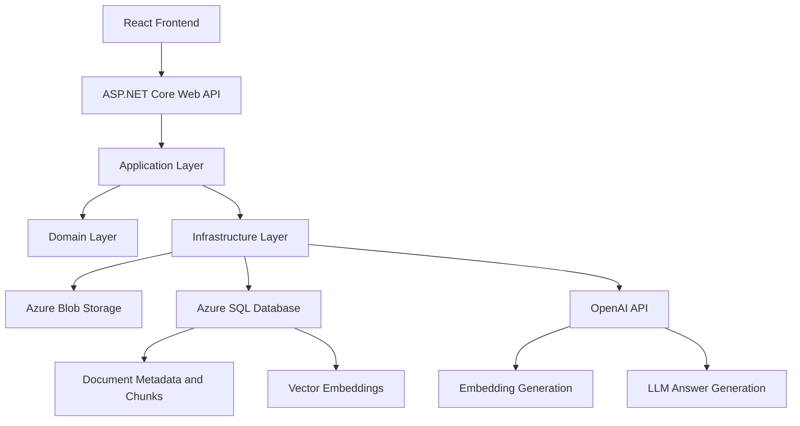
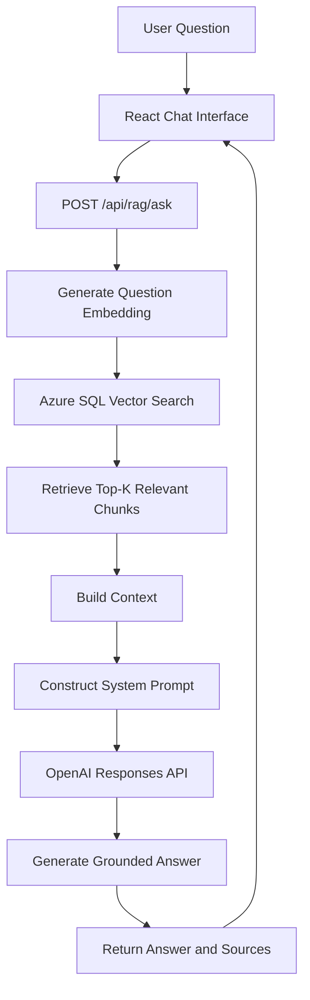

# Enterprise Knowledge Assistant – RAG Application

An enterprise document question-answering application built using **ASP.NET Core, React, OpenAI APIs, Azure SQL Vector Search and Azure Blob Storage**.

The application uses Retrieval-Augmented Generation (RAG) to retrieve relevant information from indexed enterprise documents and generate context-aware answers using a Large Language Model (LLM). Answers include references to the source documents to improve transparency and traceability.

---

## Project Overview

Enterprise organizations maintain large volumes of documents containing policies, procedures, technical guidelines and business information.

Finding relevant information manually across these documents can be time-consuming.

The Enterprise Knowledge Assistant addresses this challenge by combining semantic search and Generative AI.

Users can ask natural-language questions and receive answers grounded in relevant document content rather than relying solely on the LLM's pretrained knowledge.

### Key Capabilities

- Document ingestion and metadata management.
- Text extraction and document chunking.
- Embedding generation using OpenAI APIs.
- Vector storage and similarity search using Azure SQL Database.
- Context-aware answer generation using OpenAI Responses API.
- Source attribution with document names and retrieved chunk references.
- React-based conversational user interface.
- Clean Architecture-based .NET backend.

---

## Architecture

The solution follows Clean Architecture principles and separates presentation, application logic, domain entities and infrastructure integrations.

### High-Level Architecture



### RAG Workflow



---

## Technology Stack

| Category | Technology |
|---|---|
| Backend | C#, ASP.NET Core Web API |
| Architecture | Clean Architecture |
| Frontend | React JS, Vite |
| AI Integration | OpenAI API, Responses API |
| Embeddings | OpenAI Embedding API |
| Vector Database | Azure SQL Database |
| Vector Search | SQL VECTOR data type, cosine distance |
| Document Storage | Azure Blob Storage |
| Database Access | ADO.NET, Microsoft.Data.SqlClient |
| API Testing | Swagger / OpenAPI |
| Version Control | Git, GitHub |

---

## Backend Architecture

The backend is organized into the following projects:

```text
GenAI Backend
│
├── GenAI.API
│   ├── Controllers
│   ├── Request Models
│   └── Program.cs
│
├── GenAI.Application
│   ├── Interfaces
│   ├── Services
│   └── Use Cases
│
├── GenAI.Domain
│   └── Entities
│
├── GenAI.Infrastructure
│   ├── AI
│   ├── Persistence
│   ├── Storage
│   └── Prompting
│
└── GenAI.UnitTests
```

### Layer Responsibilities

**GenAI.API**
- Exposes REST API endpoints.
- Handles HTTP requests and responses.
- Provides the entry point for the React frontend.

**GenAI.Application**
- Contains application services and business workflows.
- Defines interfaces for AI, storage and retrieval services.
- Orchestrates document ingestion and RAG answer generation.

**GenAI.Domain**
- Contains core domain entities such as Document and DocumentChunk.
- Keeps domain models independent of infrastructure implementations.

**GenAI.Infrastructure**
- Implements Azure Blob Storage integration.
- Implements Azure SQL document and vector persistence.
- Integrates OpenAI embedding and response-generation services.
- Implements prompt construction and vector search.

**GenAI.UnitTests**
- Contains the unit testing project for application components.

---

## RAG Implementation Details

### 1. Document Ingestion

The document ingestion workflow processes documents and prepares them for semantic retrieval.

Workflow:

1. Receive the document through the backend ingestion API.
2. Upload the original document to Azure Blob Storage.
3. Store document metadata in Azure SQL Database.
4. Extract the document text.
5. Split extracted text into smaller chunks.
6. Generate embeddings for the chunks.
7. Store chunk content and embeddings in Azure SQL Database.
8. Update document processing status.

### 2. Embedding Generation

OpenAI embedding APIs convert document chunks into numerical vector representations.

These embeddings capture semantic meaning and enable similarity-based retrieval.

### 3. Vector Search

Azure SQL Database is used to store and search document embeddings.

The implementation uses the SQL VECTOR data type with cosine-distance-based similarity search.

The retrieval service:

1. Generates an embedding for the user's question.
2. Executes vector similarity search.
3. Retrieves the Top-K relevant document chunks.
4. Returns the matching chunks for context construction.

### 4. Context Construction

Retrieved chunks are combined into a context string containing source document names, chunk references and document content.

This context is supplied to the LLM as part of the system prompt.

### 5. Answer Generation

The OpenAI Responses API receives:

- System instructions.
- Retrieved document context.
- Original user question.

The LLM generates an answer grounded in the retrieved context.

### 6. Source Attribution

The API response includes:

- Generated answer.
- Source document name.
- Document identifier.
- Retrieved chunk index.
- Retrieved chunk content.

This provides visibility into the document information returned by the retrieval process.

---

## API Endpoints

### Ask a Question

**Endpoint**

```http
POST /api/rag/ask
```

**Request**

```json
{
  "question": "What is the annual leave entitlement?",
  "topK": 5
}
```

**Example Response**

```json
{
  "question": "What is the annual leave entitlement?",
  "answer": "Full-time employees receive 18 working days per leave year, credited at 1.5 days per completed month.",
  "sources": [
    {
      "documentId": "document-guid",
      "fileName": "sample_employee_leave_policy_rag.pdf",
      "chunkIndex": 9,
      "content": "Full-time employees receive 18 working days per leave year..."
    }
  ]
}
```

*The response above is illustrative; actual retrieved chunks and source counts depend on the query.*

---

## Frontend

The React application provides a conversational interface for interacting with the RAG backend.

Current interface capabilities:

- Submit natural-language questions.
- Display AI-generated responses.
- Display source document references.
- Show loading and error states.
- Start a new conversation.

The current demonstration uses an already-ingested and indexed employee leave policy document.

Document upload through the React interface is planned as a future enhancement.

---

## Local Setup and Configuration

### Prerequisites

- .NET SDK compatible with the backend solution.
- Node.js and npm.
- Azure SQL Database with VECTOR support.
- Azure Storage Account and Blob Container.
- OpenAI API account and API key.
- Git.

### 1. Clone the Repository

```bash
git clone https://github.com/YOUR_GITHUB_USERNAME/Enterprise-Knowledge-Assistant-RAG.git
```

### 2. Backend Configuration

Navigate to the backend solution directory and configure the required application settings.

Required configuration includes:

- Azure SQL connection string.
- Azure Blob Storage connection string.
- Blob container name.
- OpenAI API key.

Use .NET User Secrets for local development rather than committing credentials to source control.

Example:

```bash
dotnet user-secrets set "ConnectionStrings:EnterpriseRAGDB" "YOUR_CONNECTION_STRING"
dotnet user-secrets set "Storage:ConnectionString" "YOUR_STORAGE_CONNECTION_STRING"
dotnet user-secrets set "Storage:ContainerName" "rag-documents"
```

Configure the OpenAI API key using the configuration key expected by the backend dependency-injection setup.

### 3. Run the Backend

```bash
dotnet restore
dotnet build
dotnet run --project path/to/GenAI.API/GenAI.API.csproj
```

Use the HTTPS URL shown in the application's startup output.

### 4. Run the React Frontend

Navigate to the frontend directory:

```bash
cd enterprise-knowledge-ui
```

Install dependencies:

```bash
npm install
```

Start the development server:

```bash
npm run dev
```

Open the local URL displayed by Vite, typically:

```text
http://localhost:5173
```

Ensure that the frontend API base URL points to the running ASP.NET Core API.

---

## Security Considerations

- API keys and connection strings must not be committed to Git.
- Local secrets should be maintained using .NET User Secrets.
- Azure resources should use appropriate authentication and access permissions.
- Blob containers should remain private.
- Production secrets should be stored using secure configuration mechanisms.
- API access should be protected with authentication, authorization and rate limiting before public deployment.

---

## Future Enhancements

- Document upload interface in React.
- Support for multiple document formats.
- Document-level access control and RBAC.
- Conversation history and session management.
- Hybrid search combining keyword and vector search.
- RAG evaluation using retrieval and answer-quality metrics.
- Cloud deployment with secure authentication.
- Monitoring and observability using Application Insights and OpenTelemetry.
- Improved citation relevance and source selection.

---

## Project Status

**Current status:** Working local proof of concept.

The backend supports document ingestion, embedding generation, vector retrieval and LLM-based answer generation. The React interface is integrated with the RAG question-answering endpoint.

Cloud deployment and additional production security capabilities are planned enhancements.

---

## Author

**Akash Mankar**

Senior Microsoft Technologies / AI Native Software Engineering Specialist

Areas of interest:
- Enterprise .NET Architecture
- Generative AI
- Retrieval-Augmented Generation
- Agentic AI
- Azure Cloud Solutions
- AI Application Engineering
